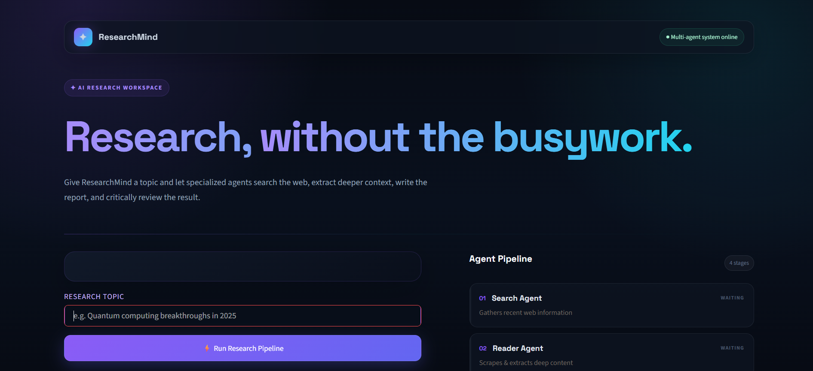
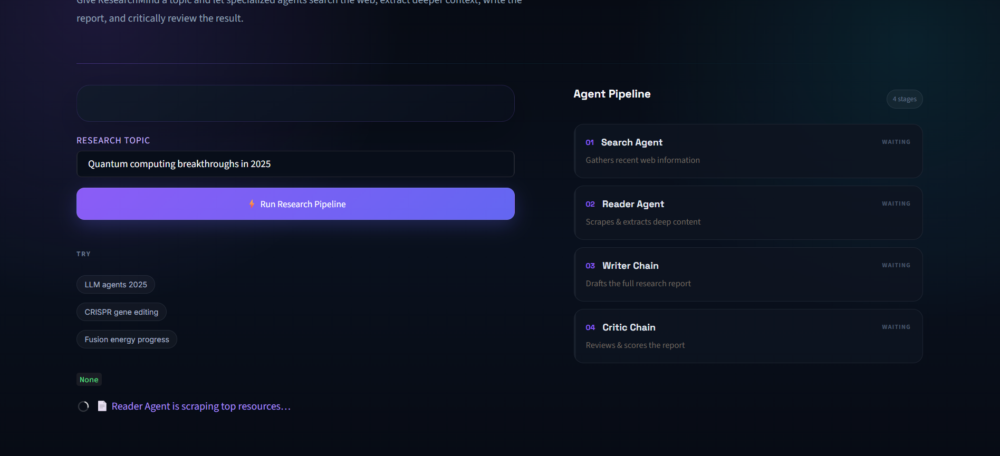
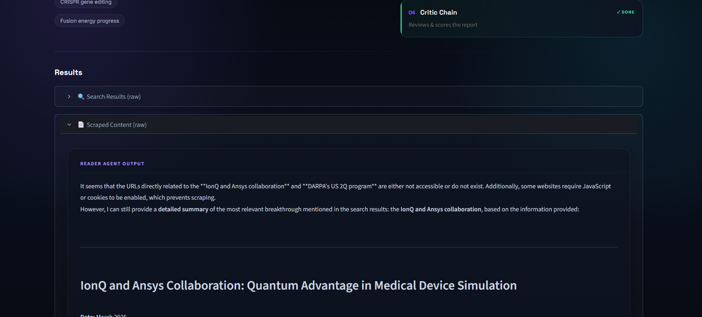
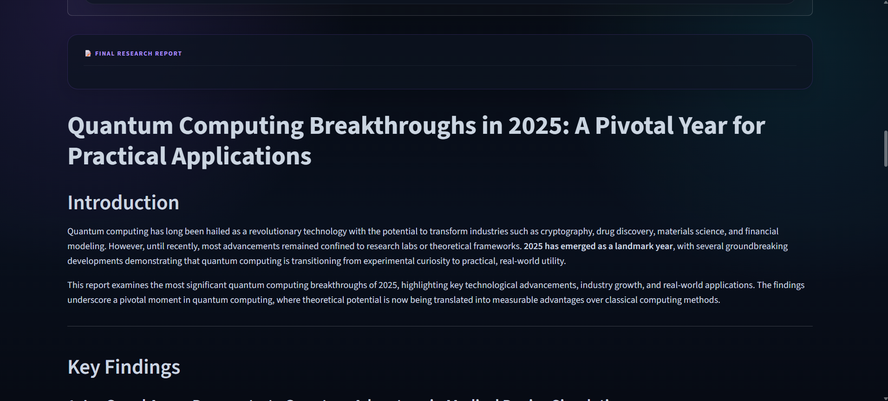
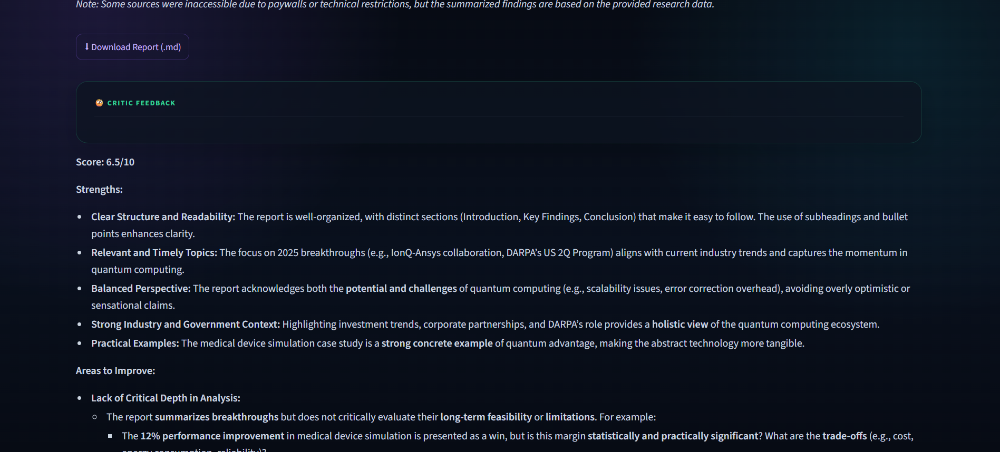

# 🔬 ResearchMind — AI Research Agent
## 🚀 Live Demo

👉 [Try ResearchMind](https://researchmind-ai-research-agent-thcaycydegszugsifycray.streamlit.app/)

> **Research, without the busywork.**

ResearchMind is a **multi-agent AI research system** built with **LangChain and Streamlit**. It takes a research topic and coordinates specialized AI agents to search for recent information, extract deeper context, generate a structured research report, and critically review the final output.

---


## ✨ Features

- 🔎 **Search Agent** — Finds recent, reliable, and detailed information about the given topic.
- 📄 **Reader Agent** — Selects relevant resources and extracts deeper content.
- ✍️ **Writer Chain** — Combines the research into a structured research report.
- 🧐 **Critic Chain** — Reviews the generated report and provides a score, strengths, and areas for improvement.
- ⚡ **Automated Research Pipeline** — Runs the complete workflow from one Streamlit interface.
- 📥 **Report Download** — Download the final research report as a Markdown file.
- 🌙 **Modern Dark UI** — A polished AI-workspace interface with gradient accents, agent status cards, and responsive result panels.

---

## 🧠 How It Works

ResearchMind follows a four-stage research pipeline:

```text
                    ┌──────────────────┐
                    │   Research Topic │
                    └────────┬─────────┘
                             │
                             ▼
                 ┌─────────────────────┐
                 │    🔎 Search Agent  │
                 │  Web Research       │
                 └──────────┬──────────┘
                            │
                            ▼
                 ┌─────────────────────┐
                 │    📄 Reader Agent  │
                 │ Scrape & Extract    │
                 └──────────┬──────────┘
                            │
                            ▼
                 ┌─────────────────────┐
                 │    ✍️ Writer Chain  │
                 │ Generate Report     │
                 └──────────┬──────────┘
                            │
                            ▼
                 ┌─────────────────────┐
                 │    🧐 Critic Chain  │
                 │ Review & Score      │
                 └──────────┬──────────┘
                            │
                            ▼
                 ┌─────────────────────┐
                 │  Final Research     │
                 │      Report         │
                 └─────────────────────┘
```

### Pipeline

1. **Enter a topic**
2. **Search Agent** gathers relevant information.
3. **Reader Agent** identifies a relevant source and extracts deeper context.
4. **Writer Chain** combines the collected research and creates the report.
5. **Critic Chain** evaluates the report.
6. **View and download** the final report.

---

## 🖥️ Application Preview

### Research Workspace

The application provides a modern dark-themed workspace where users can enter a topic and launch the complete research pipeline.



### Agent Pipeline

The interface displays the four stages of the research workflow and their current status:

- `WAITING`
- `RUNNING`
- `✓ DONE`



### Research Results

Raw search and scraped outputs can be inspected through expandable result sections.



### Generated Research Report

The Writer Chain produces a structured report with sections such as introduction, key findings, analysis, and conclusion.



### Critic Feedback

The Critic Chain evaluates the report and highlights its strengths and areas that could be improved.



---

## 🛠️ Tech Stack

| Technology | Purpose |
|---|---|
| **Python** | Core application language |
| **Streamlit** | Interactive web UI |
| **LangChain** | Agent and LLM orchestration |
| **Multi-Agent Architecture** | Specialized research workflow |
| **Web Search / Scraping Tools** | Information gathering and extraction |
| **Markdown** | Generated research report format |
| **python-dotenv** | Environment variable management |

---

## 📂 Project Structure

```text
Multi Agent System/
│
├── app.py                  # Streamlit application and UI
├── agents.py               # Search and scraping agents + writer/critic chains
├── pipeline.py             # Research pipeline logic
├── tools.py                # Tools used by the agents
├── requirements.txt        # Python dependencies
├── .env                    # API keys and environment variables
│
└── screenshots/
    ├── home.png
    ├── execution.png
    ├── research_results.png
    ├── generated_report.png
    └── critic_feedback.png
```

> **Note:** Keep your `.env` file private and do not commit API keys or other secrets to GitHub.

---

## 🚀 Getting Started

### 1. Clone the repository

```bash
git clone https://github.com/<your-username>/researchmind-ai-research-agent.git
cd researchmind-ai-research-agent
```

### 2. Create a virtual environment

#### Windows

```bash
python -m venv .venv
.venv\Scripts\activate
```

#### macOS / Linux

```bash
python3 -m venv .venv
source .venv/bin/activate
```

### 3. Install dependencies

```bash
pip install -r requirements.txt
```

### 4. Configure environment variables

Create a `.env` file in the project root:

```env
# Add the API keys required by your agents/tools here
YOUR_API_KEY=your_api_key_here
```

Use the exact variable names expected by your `agents.py` and `tools.py` files.

### 5. Run the application

```bash
streamlit run app.py
```

The Streamlit application will open in your browser.

---

## 💡 Example Research Topics

Try topics such as:

```text
LLM agents 2025
CRISPR gene editing
Fusion energy progress
Quantum computing breakthroughs in 2025
```

You can also enter any other research topic that can benefit from web-based information gathering and analysis.

---

## 🔄 Agent Responsibilities

### 🔎 Search Agent

The Search Agent is responsible for discovering **recent, reliable, and detailed information** related to the user's research topic.

### 📄 Reader Agent

The Reader Agent works with the search results to identify a relevant resource and obtain **deeper content** from it.

### ✍️ Writer Chain

The Writer Chain receives the search results and detailed scraped content and transforms them into a **coherent research report**.

### 🧐 Critic Chain

The Critic Chain acts as a review layer. It analyzes the generated report and provides feedback such as:

- Overall score
- Strengths
- Areas for improvement
- Depth and quality of analysis
- Suggestions for making the report stronger

This additional review stage helps make the workflow more than a simple single-prompt generation system.

---

## 🎯 Why a Multi-Agent Approach?

A traditional LLM application may send a single prompt to a model and directly generate an answer.

ResearchMind separates the workflow into specialized responsibilities:

```text
Search → Read → Write → Critique
```

This allows each stage to focus on a specific task instead of asking one model call to handle the entire research process.

The architecture also makes the application easier to extend. Additional agents or tools can be introduced without redesigning the entire workflow.

---

## 📊 Example Output

For a topic such as:

> **Quantum computing breakthroughs in 2025**

ResearchMind can produce:

- Recent research findings
- Relevant industry developments
- Extracted source information
- A structured research report
- Critical evaluation of the report
- A final quality score

The generated report can then be downloaded directly from the interface as a `.md` file.

---

## 🔐 Environment & Security

Do **not** commit API keys to the repository.

Add `.env` to `.gitignore`:

```gitignore
.env
.venv/
__pycache__/
*.pyc
```

If an API key has accidentally been committed, revoke it and generate a new key.

---

## 🔮 Future Improvements

Potential extensions for ResearchMind include:

- [ ] Support for multiple research sources instead of a single selected URL
- [ ] Source citations and references in the final report
- [ ] Parallel execution of independent research agents
- [ ] Research history and saved reports
- [ ] PDF export
- [ ] DOCX export
- [ ] Source reliability scoring
- [ ] More specialized domain agents
- [ ] User-selectable research depth
- [ ] Agent execution logs and latency metrics
- [ ] Improved error handling for inaccessible websites
- [ ] Deployment to Streamlit Community Cloud

---

## 📌 Key Learning Outcomes

This project demonstrates practical implementation of:

- Multi-agent AI systems
- LangChain agent orchestration
- LLM-based information extraction
- Web research and scraping workflows
- Prompt chaining
- AI-generated report writing
- LLM-based evaluation and critique
- Streamlit application development
- Session-state based workflow management
- Environment variable and API-key management

---

## 👩‍💻 Author

**Simran Agrawal**

Built as a practical exploration of **Generative AI, LangChain, multi-agent systems, and Streamlit application development**.

---

## ⭐ Support

If you find this project useful, consider giving the repository a ⭐ on GitHub!
